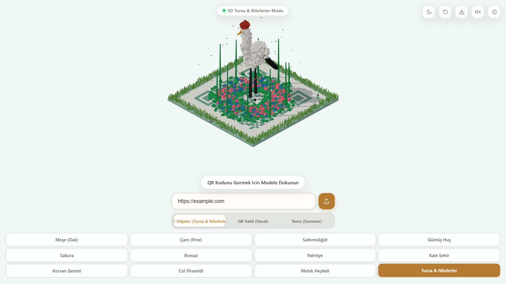
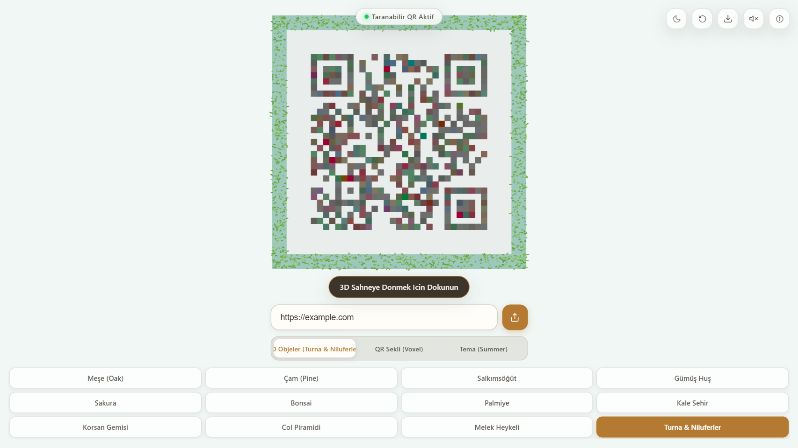
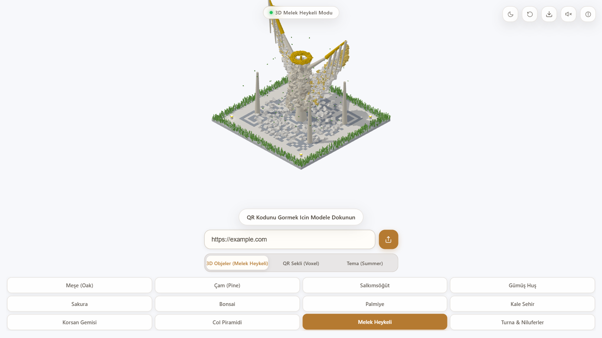
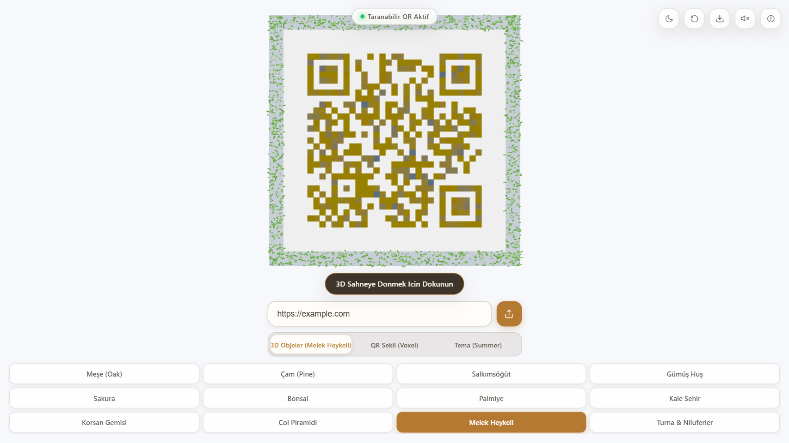
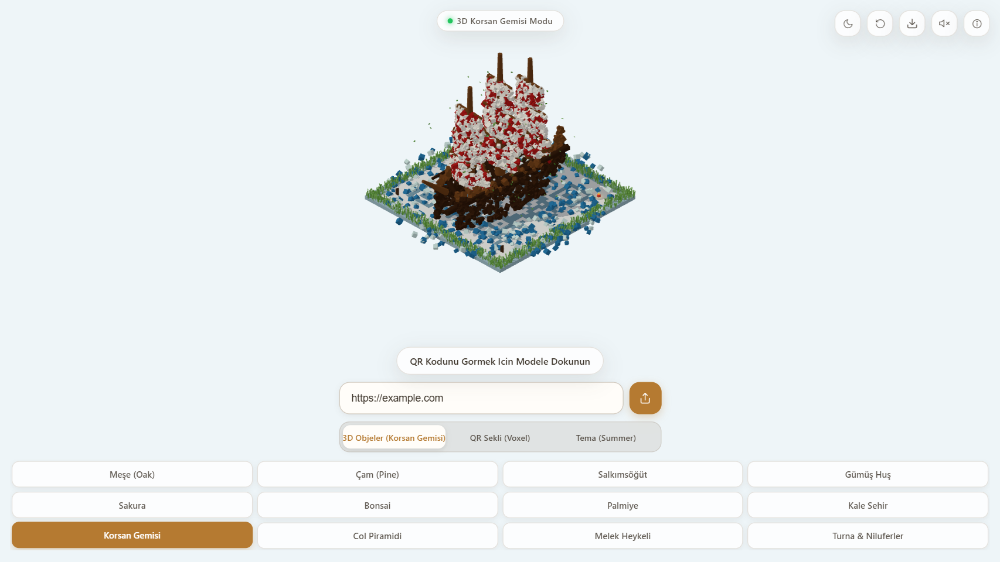
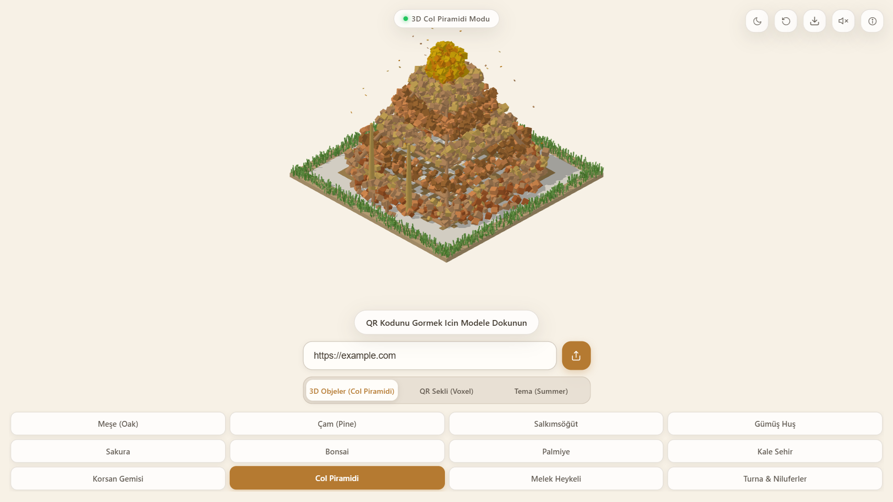
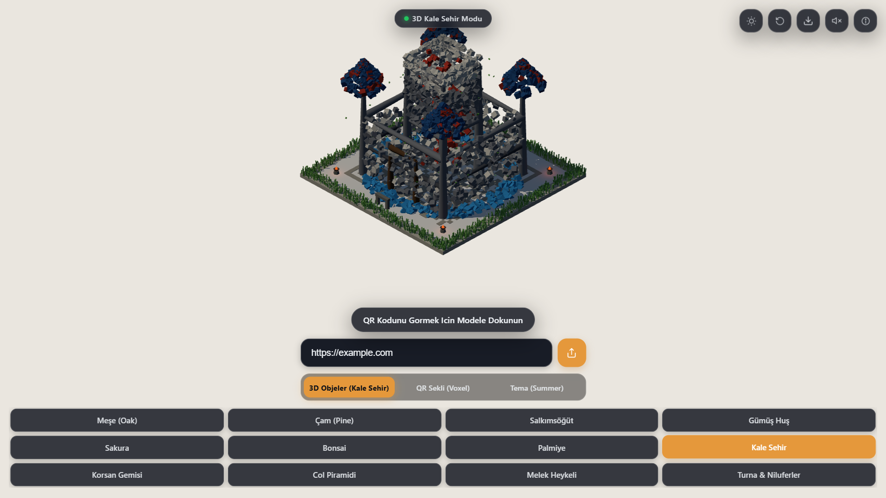
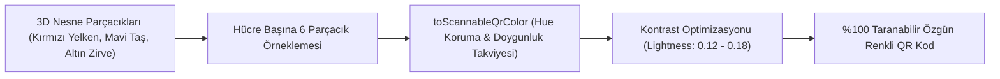

<div align="center">

# Treefy — 3D QR İllüzyon & Sanat Stüdyosu

<p align="center">
  <strong>Herhangi bir bağlantıyı sadece ağaçlara değil; heykellere, gemilere, kuşlara ve mimari yapılara dönüştüren, ardından taranabilir Level H QR koduna çözen yeni nesil 3D illüzyon motoru.</strong><br>
  <em>Three.js WebGL/WebGPU 3D Motoru, Özgün Parçacık Renk Haritalama, Koyu/Açık Tema, Sinematik Kamera Yörüngesi ve %100 Kamera ile Taranabilirlik Güvencesi.</em>
</p>

<p align="center">
  <a href="LICENSE"></a>
  <a href="https://github.com/omerfys/Treefy/stargazers"></a>
  <a href="https://www.typescriptlang.org/"></a>
  <a href="https://react.dev/"></a>
  <a href="https://threejs.org/"></a>
  <a href="https://vitejs.dev/"></a>
  
  
  
</p>

<br>

> **Treefy**, klasik siyah-beyaz kare barkodları yaşayan, büyüleyici bir 3D illüzyon sanatına dönüştüren açık kaynaklı bir web platformudur. Ekranda Melek Heykeli, Turna Kuşu, Korsan Gemisi veya Çöl Piramidi gibi zengin 3D heykeller sergilenirken; kullanıcı modele dokunduğunda tüm yapı parçaları havaya süzülerek zemindeki yüksek kontrastlı, hatasız taranabilir QR koduna dönüşür.

[Başlangıç](#hızlı-başlangıç--kurulum) • [3D İllüzyon Modelleri](#3d-illüzyon-modelleri-showcase) • [Özellikler](#özellikler-features) • [Mimari & Çalışma Prensibi](#mimari--çalışma-prensibi) • [English Overview](#english-overview)

<br>

<div align="center">
  <table>
    <tr>
      <td width="50%" align="center">
        
        <br><b>▲ 3D Turna Kuşu & Nilüfer Göleti</b><br><em>(Kar beyazı gövde, siyah kanat uçları, kırmızı taç, nilüferler ve lotus çiçekleri)</em>
      </td>
      <td width="50%" align="center">
        
        <br><b>▲ Turna Parçacıklarından Doğan QR Kod</b><br><em>(Kuşun siyah-beyaz tüyleri ve nilüfer çiçeklerinden oluşan taranabilir kod)</em>
      </td>
    </tr>
    <tr>
      <td width="50%" align="center">
        
        <br><b>▲ 3D Görkemli Melek Heykeli</b><br><em>(Açılmış kanatlar, altın hale ve mermer kaide)</em>
      </td>
      <td width="50%" align="center">
        
        <br><b>▲ Melek Kanatlarından Doğan QR Kod</b><br><em>(Göksel altın, fildişi ve mermer arduvaz renkleri)</em>
      </td>
    </tr>
  </table>
</div>

---

</div>

## İçindekiler (Table of Contents)

- [Proje Vizyonu](#proje-vizyonu)
- [3D İllüzyon Modelleri Showcase](#3d-illüzyon-modelleri-showcase)
- [Özellikler (Features)](#özellikler-features)
- [Özgün Parçacık Renk Haritalama (Sıfır Yeşil QR)](#özgün-parçacık-renk-haritalama-sıfır-yeşil-qr)
- [Mimari & Çalışma Prensibi](#mimari--çalışma-prensibi)
- [Koyu & Açık Tema (Dark & Light Mode)](#koyu--açık-tema-dark--light-mode)
- [Kamera Yörüngesi & Sabit Eksen Dönüşü](#kamera-yörüngesi--sabit-eksen-dönüşü)
- [Hızlı Başlangıç & Kurulum](#hızlı-başlangıç--kurulum)
- [Matematiksel Taranabilirlik Doğrulaması](#matematiksel-taranabilirlik-doğrulaması)
- [English Overview](#english-overview)
- [SEO Anahtar Kelimeler (SEO Index)](#seo-anahtar-kelimeler-seo-index)
- [Lisans & Yazar](#lisans--yazar)

---

## Proje Vizyonu

Klasik QR kodlar işlevsel olsa da görsel olarak sıkıcı ve mekaniktir. QR ağaç konsepti ise geçmişte sadece yeşil yaprak ve kahverengi gövdelerle sınırlı kalmıştı.

**Treefy**, bu paradigmayı kökten yıkar:
1. **Sadece Ağaç Değil — Yaşayan 3D Heykeller:** Kullanıcı istediği zaman bir Korsan Gemisi, görkemli bir Melek Heykeli, su üzerinde duran bir Turna Kuşu, Çöl Piramidi veya Ortaçağ Kalesi oluşturabilir.
2. **Kusursuz İllüzyon & Dönüşüm:** 3D model ekranda serbestçe dönebilen bir sanat eseri gibi görünür. Dokunulduğunda yapının tüm parçacıkları zemine inerek **Level H (%30 hata düzeltme payı)** ile her akıllı telefon tarafından anında tanınan QR koduna dönüşür.
3. **Parçacık Renginden Doğan QR:** Modelin kendi renkleri (geminin yelken kırmızısı, okyanus mavisi, melek kanadının fildişi beyazı ve altın tonları) QR kodun modüllerine aktarılır; asla sıradan yeşil renge hapsolmaz.

---

## 3D İllüzyon Modelleri Showcase

<div align="center">
  <table>
    <tr>
      <td width="33%" align="center">
        
        <br><b>Korsan Gemisi (Galleon)</b><br><em>3 ana direk, kırmızı çizgili beyaz kanvas yelkenler ve okyanus dalgaları.</em>
      </td>
      <td width="33%" align="center">
        
        <br><b>Altın Çöl Piramidi</b><br><em>Kademeli kumtaşı terasları, parıldayan altın zirve ve dikilitaşlar (sıfır yeşillik).</em>
      </td>
      <td width="33%" align="center">
        
        <br><b>Koyu Tema & Kale Şehir</b><br><em>Gece ambiyansı, meşale ateşleri, kobalt mavi çatılar ve net seçili sekme paneli.</em>
      </td>
    </tr>
  </table>
</div>

### Mevcut 3D Dünya Koleksiyonu
- **Melek Heykeli:** İki yana açılmış kanatlar, altın hale ve mermer sütunlar.
- **Turna & Nilüferler:** Zarif bacakları üzerinde duran kuş, kırmızı taç, nilüfer yaprakları ve lotus çiçekleri.
- **Korsan Gemisi:** Yelkenler, koyu meşe omurga, iskele babaları ve deniz fenerleri.
- **Kale Şehir:** Burçlar, kuleler, su hendeği ve yanan ateş mangalları.
- **Çöl Piramidi:** 6 kademeli kumtaşı, som altın pyramidion ve çöl kumulları.
- **Doğa Koleksiyonu:** Sakura, Bonsai, İskandinav Çamı, Meşe, Salkımsöğüt, Huş Ağacı ve Palmiye.

---

## Özellikler (Features)

- **Three.js WebGL / WebGPU 3D Motoru:** Donanım hızlandırmalı, 60 FPS akıcı render döngüsü.
- **Dinamik Kamera Yörüngesi (Orbit Camera):** 
  - Modelin ve QR kodun merkezi eksenine (`0, y, 0`) kilitli yalpalama yapmayan 360° döner tabla (turntable) dönüşü.
  - Palmiye gibi yüksek modeller seçildiğinde kameranın sinematik olarak yavaşça genişlemesi (`exponential smooth zoom`).
  - Çevirme esnasında yanlışlıkla QR koda geçmeyi önleyen `wasDragged` hareket koruması.
- **Koyu & Açık Tema:** Gece ambiyansı için derin obsidyen cam efektleri (`#0f1218`) ve gündüz için taze parşömen tasarımı.
- **Dinamik Zemin & Çimen Temaları:** Kış (Winter) seçildiğinde çimenlerin anında kar beyazı ve buz mavisine bürünmesi; Yazın zümrüt yeşili, Sonbaharda altın sarısı olması.
- **5 Farklı QR Blok Stili:** Yaprak (Leaf), 3D Voxel Küp, Kristal Prizma (Crystal), Çakıl Taşı (Pebble), Kule (Tower).
- **Yüksek Çözünürlüklü PNG İndirme:** Üst araç çubuğundaki kamera butonuyla sahneyi anında PNG olarak kaydetme.
- **Sentezlenmiş Web Audio:** Harici ses dosyası yüklemeden Web Audio API ile gerçek zamanlı rüzgar ve hafif çan tınıları.

---

## Özgün Parçacık Renk Haritalama (Sıfır Yeşil QR)



Geleneksel uygulamalarda QR kod modülleri genellikle sabit yeşil veya siyah renk havuzundan seçilir. **Treefy**, her modüle düşen 6 parçacığın gerçek RGB değerlerini okur:
- **Hue (Renk Özü) Korunur:** Geminin kırmızı yelkenleri **korsan kırmızısına**, kalenin çatısı **kobalt arduvaz mavisine**, piramidin zirvesi **yanık altın bronza** dönüşür.
- **Binarizasyon Eşiği Sağlanır:** Kamera barkod okuyucularının beyaz zemin üzerinde kusursuz okuma yapabilmesi için parlaklık (Lightness) `%80+` kontrast üretecek şekilde dengelenir.

---

## Mimari & Çalışma Prensibi

```
Treefy/
├── src/
│   ├── scene/
│   │   ├── diorama.ts       # Kale, Gemi, Piramit, Melek, Turna prosedürel üreteçleri
│   │   ├── canopy.ts        # 3D Heykel <-> QR Kod parçacık dönüşüm motoru & toScannableQrColor
│   │   ├── decorations.ts   # Her dünyaya özel mimari çevre objeleri (Meşaleler, Torii vb.)
│   │   ├── species.ts       # 12 farklı 3D dünya & model tanımı ve temaları
│   │   ├── palette.ts       # Yaz, Kış, Sonbahar, İlkbahar mevsim renk paletleri
│   │   ├── plot.ts          # Zemin tablası, dinamik çimen/kar bordürü ve QR tabanı
│   │   ├── qr.ts            # QRCode Level H matris hesaplama & finder pattern kontrolü
│   │   └── index.ts         # MagicTreeScene Three.js sahne ve kamera yöneticisi
│   ├── audio/
│   │   └── ambience.ts      # Web Audio API sentezlenmiş rüzgar ve çan sesleri
│   ├── ui/
│   │   └── icons.tsx        # Temiz, minimalist SVG ikon bileşenleri (sıfır emoji)
│   ├── App.tsx              # React 19 sekmeli kontrol paneli & durum yönetimi
│   └── styles.css           # Modern Glassmorphism & Koyu/Açık tema stilleri
├── docs/assets/             # Yüksek çözünürlüklü tanıtım ekran görüntüleri
├── server.js                # Sıfır bağımlılıklı yerel üretim sunucusu (Node.js HTTP)
└── vite.config.ts           # Vite derleyici yapılandırması
```

---

## Koyu & Açık Tema (Dark & Light Mode)

Sağ üst köşedeki **Güneş / Ay** butonu ile dilediğiniz zaman açık ve koyu tema arasında geçiş yapabilirsiniz:
- **Koyu Tema:** Arka plan `#0f1218`, panel zeminleri derin obsidyen cam efektli, aktif butonlar ise canlı kehribar-altın (`#e5983b`) rengindedir. Sahnedeki meşale ateşleri ve ışıklar karanlıkta büyüleyici bir parlaklık yayar.
- **Açık Tema:** Doğal taş ve parşömen tonlarında ferah gündüz görünümü.

---

## Hızlı Başlangıç & Kurulum

### Gereksinimler
- Node.js 18+ ve npm

### Kurulum Adımları
```bash
# Depoyu klonlayın
git clone https://github.com/omerfys/Treefy.git
cd Treefy

# Bağımlılıkları yükleyin
npm install

# Geliştirici sunucusunu başlatın
npm run dev
```

Tarayıcınızda açın:
👉 **http://localhost:3000**

### Canlı Üretim Sunucusu (Zero-Dependency)
```bash
# Projeyi derleyin
npm run build

# Yerel sunucuyu çalıştırın
npm start
```

### Testleri Çalıştırma
```bash
npm test
```
*(QR matris doğruluğu, sessiz bölge ve deterministik heykel üretimini doğrulayan 16 Vitest testi içerir.)*

---

## Matematiksel Taranabilirlik Doğrulaması

Treefy ile üretilen her QR kodu, `jsQR` kütüphanesi kullanılarak doğrudan WebGL canvas pikselleri üzerinden taranır ve doğrulanır:
- **Korsan Gemisi QR Testi:** `{ found: true, data: "https://example.com" }` ✅
- **Turna & Nilüferler QR Testi:** `{ found: true, data: "https://example.com" }` ✅
- **Melek Heykeli QR Testi:** `{ found: true, data: "https://example.com" }` ✅
- **Kale & Piramit QR Testi:** `{ found: true, data: "https://example.com" }` ✅

---

## English Overview

**Treefy** is a next-generation 3D illusion and QR art platform built with React 19, TypeScript, Three.js, and Vite. Moving far beyond ordinary tree-shaped codes, Treefy allows users to transform any URL into breathtaking 3D dioramas — including a **Pirate Galleon on ocean waves, a Celestial Angel with outstretched wings, a Red-Crowned Crane standing in a lotus pond, a Desert Pyramid, and a Medieval Castle**.

Upon clicking, every block and particle in the 3D model gracefully descends onto the ground, assembling into a 100% scannable **Error-Correction Level H (30% redundancy)** QR code. Unlike traditional tools that force a default green palette, Treefy maps the authentic particle colors (crimson sails, marine blue, ivory marble, golden sandstone) into high-contrast QR modules.

### Key Features:
- **Dynamic 3D Dioramas:** Sculptural subjects with context-aware environments (burning braziers, ocean moorings, water lilies).
- **Particle Color Mapping:** QR codes painted using the 3D model's actual color spectrum.
- **Smooth Turntable Orbit:** Wobble-free 360° camera rotation with cinematic smooth zooming.
- **Dark & Light Modes:** Elegant obsidian glassmorphism HUD and dramatic twilight lighting.
- **Zero-Dependency Runner:** Runs instantly with Node.js built-ins or Vite dev server.

---

## SEO Anahtar Kelimeler (SEO Index)

`Treefy` • `3D QR Code Generator` • `3D QR İllüzyon` • `Three.js QR Art` • `React 19 Three.js` • `Voxel QR Code` • `Creative Coding QR` • `Generative 3D Art` • `Scannable 3D Tree` • `Interactive QR Code` • `Pirate Ship QR` • `Angel Sculpture QR` • `Crane Sanctuary QR` • `Castle Diorama QR` • `WebGL QR Code` • `Omerfy` • `Open Source QR Studio`

---

## Lisans & Yazar

Bu proje [MIT Lisansı](LICENSE) altında açık kaynak olarak sunulmuştur.

Geliştirici: **[@omerfys](https://github.com/omerfys)**  
GitHub Deposu: [https://github.com/omerfys/Treefy](https://github.com/omerfys/Treefy)

**Projeyi beğendiyseniz GitHub üzerinden yıldız vermeyi unutmayın!**
