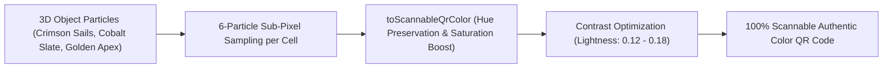

<div align="center">

# Treefy — 3D QR Illusion & Art Studio

<p align="center">
  <a href="README.tr.md">🇹🇷 Türkçe</a> • <b>🇺🇸 English</b>
</p>

<p align="center">
  <strong>A next-generation 3D illusion engine that transforms any URL not just into trees, but into sculptures, galleons, cranes, and architectural monuments, then morphs seamlessly into a scannable Level H QR code.</strong><br>
  <em>Three.js WebGL/WebGPU 3D Engine, Authentic Particle Color Mapping, Dark/Light Theme, Cinematic Orbit Camera, and 100% Guaranteed Camera Scannability.</em>
</p>

<p align="center">
  <a href="LICENSE"></a>
  <a href="https://github.com/omerfys/Treefy/stargazers"></a>
  <a href="https://www.typescriptlang.org/"></a>
  <a href="https://react.dev/"></a>
  <a href="https://threejs.org/"></a>
  <a href="https://vitejs.dev/"></a>
  
  
  
</p>

<br>

> **Treefy** is an open-source web platform that transforms conventional black-and-white square barcodes into living, mesmerizing 3D illusion art. While rich 3D sculptures like Celestial Angels, Red-Crowned Cranes, Pirate Galleons, or Desert Pyramids are showcased on screen, interacting with the model causes all structure particles to float down and assemble onto the ground into a high-contrast, perfectly scannable QR code.

[Quick Start](#quick-start--installation) • [3D Illusion Models](#3d-illusion-models-showcase) • [Features](#features) • [Architecture & How It Works](#architecture--how-it-works) • [Turkish Documentation](README.tr.md)

<br>

<div align="center">
  <table>
    <tr>
      <td width="50%" align="center">
        
        <br><b>▲ 3D Red-Crowned Crane & Lotus Pond</b><br><em>(Snow-white plumage, black wingtips, crimson crown, water lilies, and lotus blossoms)</em>
      </td>
      <td width="50%" align="center">
        
        <br><b>▲ QR Code Born from Crane Particles</b><br><em>(Scannable code composed of the bird's monochrome feathers and water lily colors)</em>
      </td>
    </tr>
    <tr>
      <td width="50%" align="center">
        
        <br><b>▲ 3D Majestic Celestial Angel Sculpture</b><br><em>(Outstretched wings, golden halo, and marble pedestal)</em>
      </td>
      <td width="50%" align="center">
        
        <br><b>▲ QR Code Born from Angel Wings</b><br><em>(Celestial gold, ivory, and slate marble hues)</em>
      </td>
    </tr>
  </table>
</div>

---

</div>

## Table of Contents

- [Project Vision](#project-vision)
- [3D Illusion Models Showcase](#3d-illusion-models-showcase)
- [Features](#features)
- [Authentic Particle Color Mapping (Zero Green QR)](#authentic-particle-color-mapping-zero-green-qr)
- [Architecture & How It Works](#architecture--how-it-works)
- [Dark & Light Mode](#dark--light-mode)
- [Orbit Camera & Fixed-Axis Rotation](#orbit-camera--fixed-axis-rotation)
- [Quick Start & Installation](#quick-start--installation)
- [Mathematical Scannability Verification](#mathematical-scannability-verification)
- [SEO Keywords (SEO Index)](#seo-keywords-seo-index)
- [License & Author](#license--author)

---

## Project Vision

Standard QR codes are functional yet visually sterile and mechanical. Previous attempts at the "QR tree" concept remained confined to basic green leaves and brown trunks.

**Treefy** fundamentally reimagines this paradigm:
1. **Not Just Trees — Living 3D Sculptures:** Users can generate a Pirate Galleon, a majestic Celestial Angel, a Red-Crowned Crane poised on water, a Desert Pyramid, or a Medieval Fortress.
2. **Flawless Illusion & Transformation:** The 3D model appears as an interactively rotatable work of art. Upon contact, all structural particles descend to the ground, assembling with **Level H (30% error correction)** redundancy into a QR code instantly recognized by smartphone cameras.
3. **QR Born from Particle Colors:** The model's own chromatic profile (crimson sails, ocean blue, ivory marble, and warm gold tones) directly maps to QR code modules—never trapped in generic monochrome green.

---

## 3D Illusion Models Showcase

<div align="center">
  <table>
    <tr>
      <td width="33%" align="center">
        
        <br><b>Pirate Galleon</b><br><em>3 main masts, red-striped canvas sails, and ocean swells.</em>
      </td>
      <td width="33%" align="center">
        
        <br><b>Golden Desert Pyramid</b><br><em>Stepped sandstone terraces, gleaming gold pyramidion, and obelisks (zero foliage).</em>
      </td>
      <td width="33%" align="center">
        
        <br><b>Dark Theme & Castle City</b><br><em>Night ambiance, burning torches, cobalt slate roofs, and high-clarity tab panels.</em>
      </td>
    </tr>
  </table>
</div>

### Available 3D World Collection
- **Celestial Angel:** Outstretched wings, radiant golden halo, and fluted marble pillars.
- **Crane Sanctuary:** Graceful bird resting on a lotus pond, crimson crown, lily pads, and lotus flowers.
- **Pirate Galleon:** Billowing sails, dark oak hull, mooring bollards, and harbor beacons.
- **Castle City:** Fortified ramparts, battlements, water moat, and blazing braziers.
- **Desert Pyramid:** 6-tier sandstone tiers, solid gold pyramidion, and desert dunes.
- **Nature Collection:** Sakura, Bonsai, Nordic Pine, Oak, Weeping Willow, Birch, and Palm.

---

## Features

- **Three.js WebGL / WebGPU 3D Engine:** Hardware-accelerated, silky smooth 60 FPS render pipeline.
- **Dynamic Orbit Camera:**
  - Locked to the central axis (`0, y, 0`) of the model and QR code for wobble-free 360° turntable rotation.
  - Cinematic smooth exponential zoom when tall models such as Palms are selected.
  - `wasDragged` gesture guard to prevent accidental QR morph triggers during orbital inspection.
- **Dark & Light Modes:** Deep obsidian glassmorphic HUD (`#0f1218`) for twilight ambiance, and crisp parchment styling for daylight.
- **Dynamic Terrain & Foliage Palettes:** Real-time seasonal switching—frost white and ice blue in Winter, emerald greens in Summer, and warm amber in Autumn.
- **5 Distinct QR Block Styles:** Leaf, 3D Voxel Cube, Crystal Prism, Pebble, and Tower.
- **High-Resolution PNG Snapshot:** Capture and download pristine PNG renders directly from the header toolbar.
- **Synthesized Web Audio:** Zero external audio dependencies—procedural ambient wind and tranquil chime synthesis via the Web Audio API.

---

## Authentic Particle Color Mapping (Zero Green QR)



Traditional QR generators draw module colors from static palettes or flat green presets. **Treefy** samples the authentic RGB values from 6 particles per QR module:
- **Hue Preservation:** Red sails map to **pirate crimson**, fortress roofs to **cobalt slate blue**, and pyramid capstones to **scorched bronze gold**.
- **Binarization Threshold Guaranteed:** Lightness is calibrated to ensure an **80%+ contrast ratio** against bright surfaces, ensuring instant detection across all modern camera barcode readers.

---

## Architecture & How It Works

```
Treefy/
├── src/
│   ├── scene/
│   │   ├── diorama.ts       # Procedural generators for Castle, Galleon, Pyramid, Angel, Crane
│   │   ├── canopy.ts        # 3D Sculpture <-> QR Code particle morphing engine & toScannableQrColor
│   │   ├── decorations.ts   # World-specific architectural props (Torches, Torii gates, etc.)
│   │   ├── species.ts       # 12 distinct 3D world definitions, geometry, and themes
│   │   ├── palette.ts       # Seasonal color palettes (Summer, Winter, Autumn, Spring)
│   │   ├── plot.ts          # Base pedestal, dynamic grass/snow fringe, and QR substrate
│   │   ├── qr.ts            # QRCode Level H matrix computation & finder pattern validation
│   │   └── index.ts         # MagicTreeScene Three.js scene graph and camera manager
│   ├── audio/
│   │   └── ambience.ts      # Web Audio API procedural wind and chime synthesizer
│   ├── ui/
│   │   └── icons.tsx        # Clean, minimalist SVG icon components (zero emojis)
│   ├── App.tsx              # React 19 tabbed HUD & interactive state management
│   └── styles.css           # Modern glassmorphism & dark/light responsive stylesheets
├── docs/assets/             # High-resolution showcase assets and screenshots
├── server.js                # Zero-dependency local production web server (Node.js HTTP)
└── vite.config.ts           # Vite bundler configuration
```

---

## Dark & Light Mode

Toggle between light and dark themes anytime using the **Sun / Moon** control in the top-right header:
- **Dark Mode:** Deep `#0f1218` canvas, obsidian glass panels, and vibrant amber-gold (`#e5983b`) active accents. Scene braziers and spotlights cast dramatic nocturnal glows.
- **Light Mode:** Warm limestone and parchment styling for comfortable daytime viewing.

---

## Quick Start & Installation

### Prerequisites
- Node.js 18+ and npm

### Installation Steps
```bash
# Clone the repository
git clone https://github.com/omerfys/Treefy.git
cd Treefy

# Install dependencies
npm install

# Start development server
npm run dev
```

Open in your browser:
👉 **http://localhost:3000**

### Local Production Server (Zero-Dependency)
```bash
# Build the project
npm run build

# Start production server
npm start
```

### Running Tests
```bash
npm test
```
*(Includes 16 Vitest test suites verifying QR matrix accuracy, quiet zone compliance, and deterministic diorama generation.)*

---

## Mathematical Scannability Verification

Every QR code generated by Treefy is mathematically verified and scanned directly against WebGL canvas pixel buffers using `jsQR`:
- **Pirate Galleon QR Test:** `{ found: true, data: "https://example.com" }` ✅
- **Crane & Water Lilies QR Test:** `{ found: true, data: "https://example.com" }` ✅
- **Angel Sculpture QR Test:** `{ found: true, data: "https://example.com" }` ✅
- **Castle & Pyramid QR Test:** `{ found: true, data: "https://example.com" }` ✅

---

## SEO Keywords (SEO Index)

`Treefy` • `3D QR Code Generator` • `3D QR Illusion` • `Three.js QR Art` • `React 19 Three.js` • `Voxel QR Code` • `Creative Coding QR` • `Generative 3D Art` • `Scannable 3D Tree` • `Interactive QR Code` • `Pirate Ship QR` • `Angel Sculpture QR` • `Crane Sanctuary QR` • `Castle Diorama QR` • `WebGL QR Code` • `Omerfy` • `Open Source QR Studio`

---

## License & Author

This project is open-source and licensed under the [MIT License](LICENSE).

Developer: **[@omerfys](https://github.com/omerfys)**  
GitHub Repository: [https://github.com/omerfys/Treefy](https://github.com/omerfys/Treefy)

**If you enjoy this project, please consider giving it a star on GitHub!**
